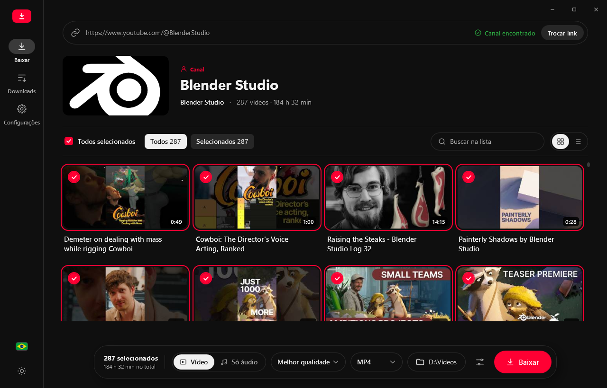
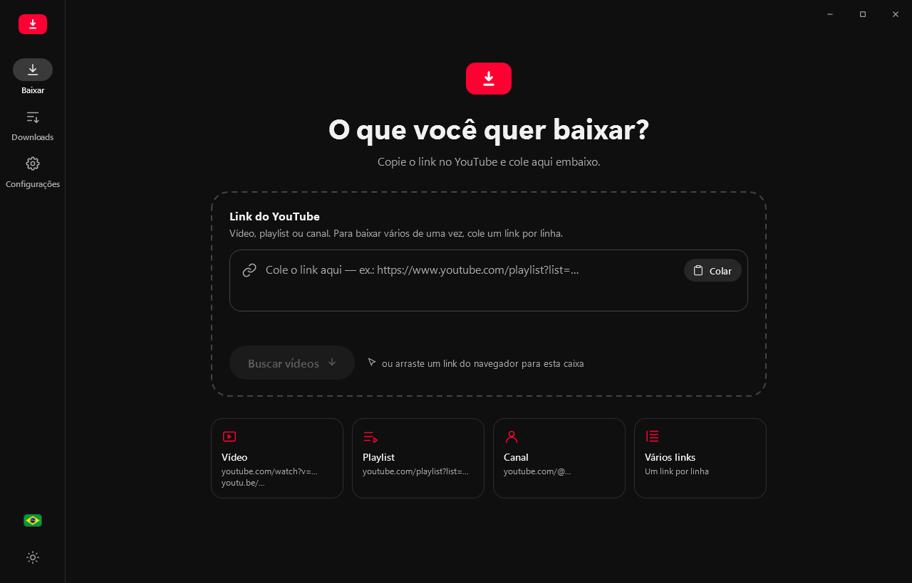
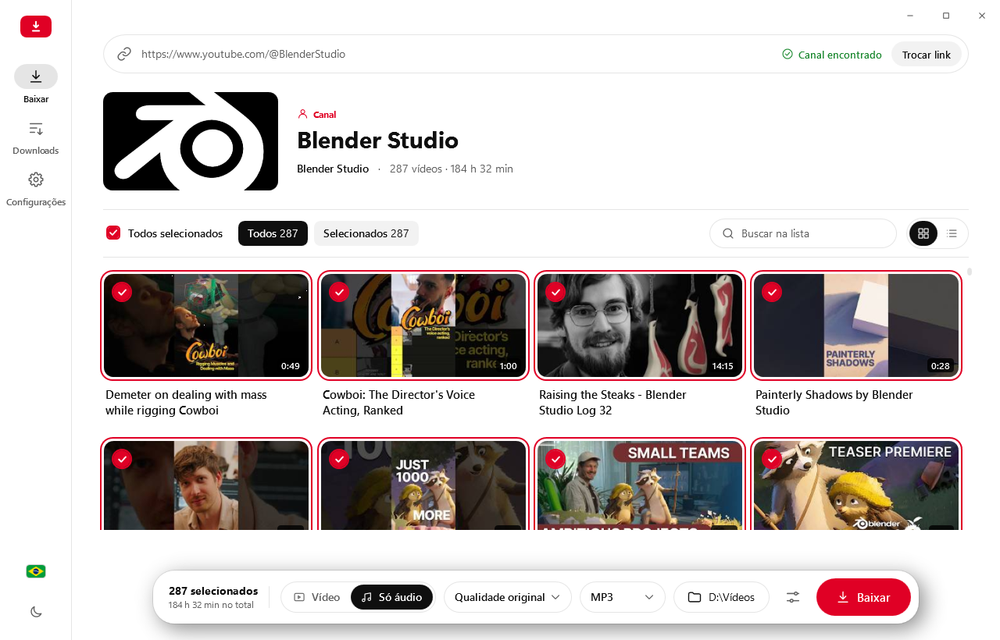

# YouTube Playlist Downloader Revamped

Baixe vídeos, playlists e canais inteiros do YouTube, em vídeo ou só o áudio, num app para Windows com interface moderna, tema claro e escuro e 14 idiomas.

Este projeto é um fork com interface e fluxo de uso totalmente refeitos do [YouTube Playlist Downloader](https://github.com/shaked6540/YoutubePlaylistDownloader) original. Os dois são independentes: use o que preferir.



| Tela inicial | Tema claro |
| --- | --- |
|  |  |

## Recursos

- **Cole e pronto:** aceita link de vídeo, playlist ou canal (`youtube.com/@nome`). Cole vários links, um por linha, para baixar tudo de uma vez.
- **Escolha o que baixar:** veja os vídeos da playlist em grade ou lista, filtre, busque e marque só os que quiser. O app avisa quais já existem na pasta.
- **Vídeo ou só áudio:** MP4 ou MKV até 8K, ou áudio em MP3, M4A, AAC, OPUS, FLAC, WAV, OGG e WEBM. Também dá para salvar o áudio original, sem conversão.
- **Fila de downloads:** vários downloads ao mesmo tempo, com progresso, velocidade e tempo restante. Dá para pausar, retomar, cancelar e tentar de novo.
- **Tags automáticas:** título, artista, álbum e capa nos arquivos de áudio.
- **Nome dos arquivos do seu jeito:** padrões como `$index - $title`, com prévia ao vivo.
- **Legendas e faixa de áudio:** baixa legendas e escolhe o idioma do áudio em vídeos dublados.
- **Detalhes que ajudam:** detecta links copiados, aceita links arrastados do navegador, mostra notificação ao terminar e o progresso na barra de tarefas.
- **14 idiomas:** português (Brasil), English, Español, Deutsch, Français, Italiano, Nederlands, Polski, Română, Türkçe, Русский, עברית, العربية e 中文.

## Instalação

1. Baixe o **[instalador mais recente](https://github.com/danfreitas97/YoutubePlaylistDownloaderRevamped/releases/latest/download/YoutubePlaylistDownloaderRevamped-Setup.exe)** (ou veja todas as versões em [Releases](https://github.com/danfreitas97/YoutubePlaylistDownloaderRevamped/releases)).
2. Abra o `YoutubePlaylistDownloaderRevamped-Setup.exe` e siga as telas.

Se aparecer a tela azul **"O Windows protegeu o computador"**, clique em **Mais informações** e depois em **Executar assim mesmo**. Esse aviso aparece em apps novos que ainda não têm uma assinatura digital paga. Não quer dizer que haja algo errado com o instalador.

O app funciona no Windows 10 e 11 (64 bits) e não precisa de nada instalado antes. Ele pode ficar instalado ao lado do app original, sem conflito.

## Como usar

1. Copie o link no YouTube.
2. Abra o app: ele sugere o link copiado. Se não sugerir, cole no campo **Link do YouTube** e clique em **Buscar vídeos**.
3. Marque os vídeos que quiser, escolha **Vídeo** ou **Só áudio**, a qualidade, o formato e a pasta.
4. Clique em **Baixar** e acompanhe tudo na tela **Downloads**.

Na primeira vez que você baixar um vídeo ou converter um áudio, o app vai pedir para baixar o **FFmpeg**, um programa gratuito que junta vídeo e áudio e converte as músicas. É só clicar em **Baixar**: são cerca de 75 MB, uma vez só, e depois o seu download continua sozinho.

## "O YouTube está bloqueando as requisições"

Às vezes o YouTube limita temporariamente o acesso anônimo de uma conexão (erro 429). Quando isso acontecer, clique em **Usar minha conta do YouTube** no próprio aviso, ou vá em **Configurações › Conta do YouTube › Entrar com o YouTube**.

Abre uma janela com a tela de login do Google. Entre normalmente e a janela fecha sozinha quando terminar. O app guarda só a sessão do YouTube, no seu computador, em `%AppData%\YouTube Playlist Downloader Revamped`. Sua senha nunca passa pelo app. Para desconectar, clique em **Remover** na mesma tela.

Se a janela de login não abrir (ela usa o Microsoft Edge WebView2, que já vem no Windows 10 e 11), dá para importar um `cookies.txt` exportado do navegador com uma extensão como a **Get cookies.txt LOCALLY**: **Configurações › Conta do YouTube › Ou importe um arquivo cookies.txt**.

## Problemas e sugestões

Encontrou um bug ou tem uma ideia? [Abra uma issue](https://github.com/danfreitas97/YoutubePlaylistDownloaderRevamped/issues) contando o que aconteceu. Se puder, anexe o log de erros: **Configurações › Avançado › Abrir pasta**, arquivo `Errors.txt`. Toda issue é avaliada e corrigida.

## Compilando o código

Requisitos: Windows e [.NET 8 SDK](https://dotnet.microsoft.com/download/dotnet/8.0).

```
git clone https://github.com/danfreitas97/YoutubePlaylistDownloaderRevamped.git
cd YoutubePlaylistDownloaderRevamped
dotnet build YPDRApp/YoutubePlaylistDownloader.csproj -c Release
```

Para gerar o instalador, instale o [Inno Setup 6.6 ou superior](https://jrsoftware.org/isinfo.php) (`winget install JRSoftware.InnoSetup`) e rode `./YPDSetup/build.ps1`. O instalador sai em `YPDSetup/output`. O CI usa o Inno Setup 6.7.3.

### Testes e CI

Execute `dotnet test YoutubePlaylistDownloader.sln -c Release` no Windows. Os testes cobrem reconhecimento de links e o fluxo de seleção/nome de arquivo de vídeo único. Links de vídeo com `list=` baixam somente o vídeo; para carregar a playlist, use `https://www.youtube.com/playlist?list=ID`.

O workflow **CI** compila, executa os testes e gera o instalador em cada push de branch e pull request. Os resultados dos testes e o instalador ficam nos artifacts da execução em **Actions**.

Há também testes opcionais que baixam o áudio original e o MP4 de um vídeo público, passando pelo resolvedor e pelo processamento de download. Eles exigem acesso à rede e FFmpeg instalado (pelo app ou no `PATH`). Para executá-los no PowerShell:

```powershell
$env:YPDR_LIVE_TESTS = '1'
dotnet test YoutubePlaylistDownloader.sln -c Release --filter Category=Integration
Remove-Item Env:YPDR_LIVE_TESTS
```

Esses testes dependem da disponibilidade e dos limites do YouTube; ficam desativados no CI para não tornar o resultado dependente de bloqueios externos.

### Publicando uma release

Depois de enviar as alterações para o GitHub e conferir o CI, atualize `YPDRApp/changelog.txt` e a versão padrão em `YPDRApp/YoutubePlaylistDownloader.csproj`, faça commit e envie uma tag estável (use uma versão ainda não publicada):

```powershell
git tag v2.0.1
git push origin v2.0.1
```

O workflow **Release** testa o código da tag, publica o app autocontido para Windows x64 e cria a GitHub Release com o instalador `YoutubePlaylistDownloaderRevamped-Setup.exe`, `SHA256SUMS.txt`, `version.txt` e `changelog.txt`. A versão da tag é aplicada ao executável, ao instalador e aos metadados. Não é necessário cadastrar um PAT: o workflow usa o `GITHUB_TOKEN` com escrita apenas no job de publicação. Tags de pré-release não são aceitas.

O atualizador passa a consultar os arquivos da release publicada e baixa o instalador da versão anunciada. Para alcançar instalações antigas que ainda consultam os arquivos na branch `main`, atualize também `latestVersion.txt`, `latestVersionWithRevision.txt` e `latestVersionLink.txt` **depois** de a release estar disponível. O último deve apontar para o instalador dessa tag.

Para testar o empacotamento local com a versão desejada: `./YPDSetup/build.ps1 -Version 2.0.1`.

Para baixar vídeo e converter áudio, o app usa o [FFmpeg](https://ffmpeg.org/). Ele procura o `ffmpeg.exe` ao lado do executável, depois em `%AppData%\YouTube Playlist Downloader Revamped` e por fim no `PATH`. Se não achar, oferece baixar uma versão pronta do [FFmpegBin](https://github.com/Tyrrrz/FFmpegBin) para a pasta do app.

Tecnologias: WPF (.NET 8), [CommunityToolkit.Mvvm](https://github.com/CommunityToolkit/dotnet), [YoutubeExplode](https://github.com/Tyrrrz/YoutubeExplode), [TagLib#](https://github.com/mono/taglib-sharp), [VirtualizingWrapPanel](https://github.com/sbaeumlisberger/VirtualizingWrapPanel) e [WebView2](https://learn.microsoft.com/microsoft-edge/webview2/).

## Aviso

Este app não é afiliado ao YouTube nem ao Google. Baixar vídeos pode ir contra os termos de serviço do YouTube. Use com responsabilidade e respeite os direitos autorais de quem cria o conteúdo.

## Licença

Distribuído sob a [Licença Apache 2.0](LICENSE), a mesma do projeto original. Este fork modifica o código original: a interface foi reescrita e a lógica de download foi reorganizada. As licenças das bibliotecas usadas estão em [License.txt](YPDRApp/License.txt).

## Créditos

Este projeto existe graças ao [YouTube Playlist Downloader](https://github.com/shaked6540/YoutubePlaylistDownloader), criado por [shaked6540](https://github.com/shaked6540), que é a base deste fork. Agradecimento também às pessoas que traduziram o app original: Dong Cunrui (董存瑞), RichyZ99, Jhonatan Lima (Heremitus), İskender Alpsakarya e Alp Eren Gençoğlu (Türkçe), Stephan Komov (Deutsch), Elta e Zebre2007-2 (Français), Ahmed Waaer (العربية), Bartlomiej Szmolke (Polski), Timofey Dedov (Русский) e deeaeu (Română).
